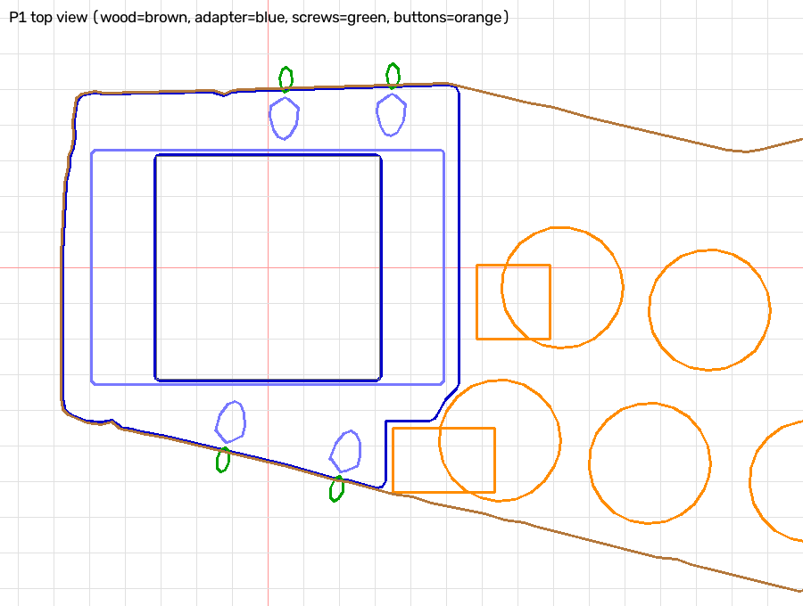
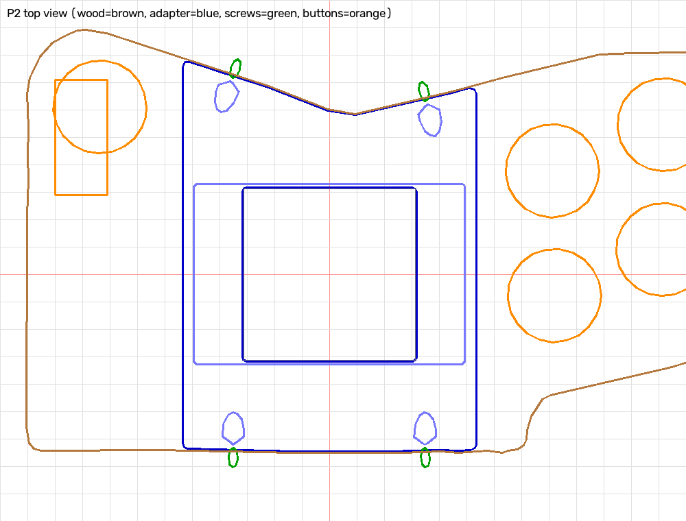

# Arcade Cabinet Seimitsu Stick Adapter

Two printed adapters to mount a **Seimitsu LS-32-01** joystick in an arcade cabinet without drilling the steel sheet of the control panel.

The panel is a 14.5 mm wood board with a 1.8 mm steel sheet on top, which comes off. The board has a through cut-out per player, with a different shape for P1 and P2. Each adapter goes in its cut-out, centred on the existing stick hole of the sheet:

- With the sheet off, the adapter drops into the cut-out from above. It is fixed with **6 wood screws driven sideways into the walls of the cut-out**, 3 per side. They start from the top face, pointing 25° down and out, so the screwdriver comes in from above with nothing in the way.
- The **stick body** (62.5 mm square) goes in from below through a 63.5 mm square hole. The adapter has two thicknesses:
  - Under the stick, in a 94 × 94 mm square that covers the PCB and the microswitch tabs, it is 11.95 mm thick: 10.3 mm under the plate, ending 0.6 mm above the PCB and microswitches (10.9 mm below the plate).
  - Outside that square, towards the walls, it is 14.4 mm thick and its bottom is flush with the bottom of the wood.
- The LS-32 **mounting plate** (98 × 65 × 1.85 mm) goes in from above into a pocket on the top face and is screwed to the stick body with its own 4 screws. The plate is **flush with the wood**, 0.1 mm proud, exactly as if it were mounted straight under the sheet. When the sheet goes back on, it holds the plate down.
- **Tabs under the wood** are a backup support: 3 on P1, 4 on P2. Each flat tab is screwed from below with one screw into the bottom of the wood and one into the bottom of the adapter, where it is full thickness. Even if the side screws work loose over time, the adapter can't drop. P1 has no tab on the screen side: there the full-thickness part is only 5 mm wide.

*Top view, as the player sees the panel (Y towards the screen). Brown: cut-out traced on the cardboard. Blue: adapter (the light blue rectangle is the plate pocket, the light blue shapes are the screwdriver openings on the top face). Green: screws where they cross the wall. Orange: nearby buttons and microswitches, estimated from the photos.*

## Screws

Each screw is a 3.5 × 25 countersunk wood screw:

- The head sits 2 mm below the top face, 8 mm in from the adapter edge, outside the plate pocket, so it touches neither the plate nor the sheet.
- The screw goes out of the adapter side about 5.7 mm below the top of the wood, with 3.5 mm of adapter above the hole.
- About 15.5 mm of it ends up in the wood, and the tip stops 1.9 mm above the bottom of the board.

The hole through the adapter is a 3.8 mm clearance hole: the thread only bites in the wood, so it pulls the adapter against the wall. Above each head there is a 7.6 mm channel for the head and the screwdriver bit. Where it meets the plate pocket it only joins the empty pocket, without cutting the material under the plate.

The tabs (26.5 × 14 × 4 mm) take 3.5 × 16 countersunk wood screws, heads facing down:

- Wood side: 12 mm go into the wood, 8 mm past the wall, leaving 2.5 mm before the sheet.
- Adapter side: 12 mm go into a pilot hole 2.8 mm wide and 12.5 mm deep, 5 mm inside the adapter edge, clear of the side screws.

The ball ends up about 25.8 mm above the sheet.

## How the cut-outs were measured

The outlines come from the photos of the cardboard tracings (`IMG_2067`, `IMG_2068`, and `IMG_2070`/`IMG_2071` with the plate on the tracing):

1. Each full tracing photo is registered onto the photo with the plate (SIFT on the cardboard texture).
2. The pixel → mm mapping is a least-squares fit of the plate corners and the mm ticks of the ruler and of the set square. The residuals are 0.1–0.25 mm on the ticks.
3. The script holds the centre of the marker line. The line was drawn from inside the cut-out, so the wall is past its outer edge. The first P1 fit test, built on the line centre, came out 2–3 mm short per side. The wall is now taken at the outer edge of the line (half the measured width: 1.13 mm on P1, 1.46 mm on P2), plus `TRACE_EXTRA` = 1 mm. The adapter stays `WALL_CLR` = 0.5 mm inside that.
4. The photos show the cardboard flipped. Compared with the rear view of the panel (`IMG_2063`), they are mirrored in Y. The script holds the outlines already converted to the top view.

The plate size (98 × 65, against the 97 of the datasheet) was measured on `IMG_2075`. The buttons near P1 come from the photos and are only good to about ±5 mm. The adapter keeps clear of the yellow button and of its microswitch, which points towards the stick.

## Parts

| File | Qty | What it is |
|---|---|---|
| `adapter_p1.stl` | 1 | P1 adapter, 113 × 117 × 14.4 mm |
| `adapter_p2.stl` | 1 | P2 adapter, 107 × 147 × 14.4 mm |
| `tab.stl` | 7 | Support tab 26.5 × 14 × 4 mm (3 for P1, 4 for P2), countersunk on the bed side |
| `fit_test_p1.stl`, `fit_test_p2.stl` | 1 + 1 | 1.6 mm outline of each adapter, to test the fit before the real print |
| `seimitsu_adapter.py` | – | Parametric FreeCAD script that generates everything |
| `seimitsu_adapter.FCStd` | – | FreeCAD model: wood, steel sheet, adapters, screws, tabs, a stick dummy and the buttons, in place |

Hardware:

- 12 × 3.5 × 25 countersunk wood screws, 6 per adapter (sides)
- 14 × 3.5 × 16 countersunk wood screws, 2 per tab

## Printing (Bambu Lab A1 mini)

- **Print the fit tests first.** They take a few minutes. Drop each one into its cut-out: it must go in without forcing, and the stick hole must be centred in the square hole. If it is mirrored or out of place, don't print the adapters. Tell me, or change the parameters.
- Adapters: the STL is already in print orientation, bottom face on the bed. PETG or PLA, 4 walls, 20 % infill.
  - The thinner area under the stick starts 2.45 mm above the bed: turn on supports "on build plate only". They are low and come off easily.
  - The screw holes are slanted 25°: they print without supports, at most slightly oval.
- Tabs: flat, countersink on the bed side. PETG if you can.

## Assembly

1. Take the sheet off. Lay the panel on a flat table with the top of the wood facing up.
2. Drop the adapter into the cut-out: it rests on the table and its top face ends up flush with the wood (0.1 mm below).
3. Drill a 2.5 mm pilot in the wood through each screw hole, then drive the 6 screws through the openings on the top face.
4. Turn the panel over and screw on the tabs: first the screw into the adapter, then the one into the wood, after a 2.5 mm pilot through the tab hole. Their position is in the FreeCAD model (`TabsP1`, `TabsP2`).
5. Unscrew the plate from the stick. Push the body in from below through the square hole.
6. Put the plate in the pocket from above and screw it back onto the body.
7. Put the sheet back on.

## Parameters

Everything is at the top of `seimitsu_adapter.py`:

- Fits: `LINE_HALF`, `TRACE_EXTRA` (where the wall is compared with the traced line), `WALL_CLR`, `PLATE_FIT`, `HOUSING_FIT`
- Plate height: `PLATE_PROUD`, `TOP_GAP`
- Thinner area under the stick: `PCB_CLR` (gap above the PCB), `PCB_HALF` (size)
- Width along X: `HALF_W`
- Screws: position (`SCREWS`), length, angle and head (`SCREW_*`, `HEAD_Z`, `CHANNEL_D`)
- Tabs: position (`TABS`), size and screws (`TAB_*`, `PILOT_*`)
- Positions of the buttons to avoid: `BUTTONS`

The panel and the steel sheet are only modelled roughly around the cut-outs. The cut-outs themselves are the measured ones.
