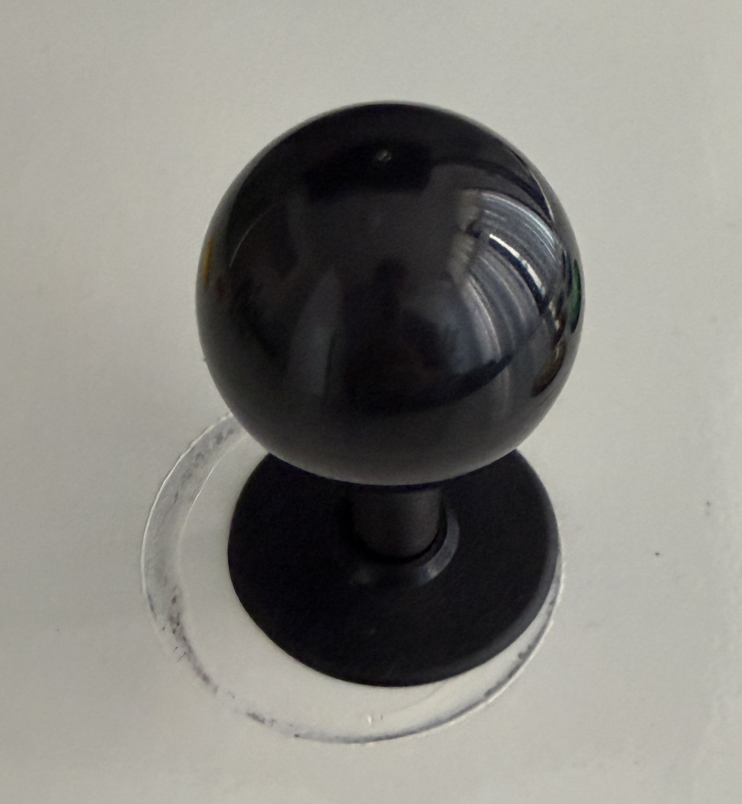
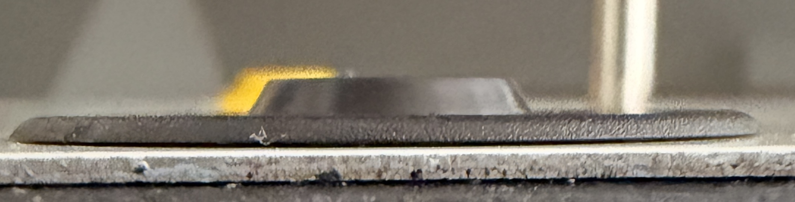
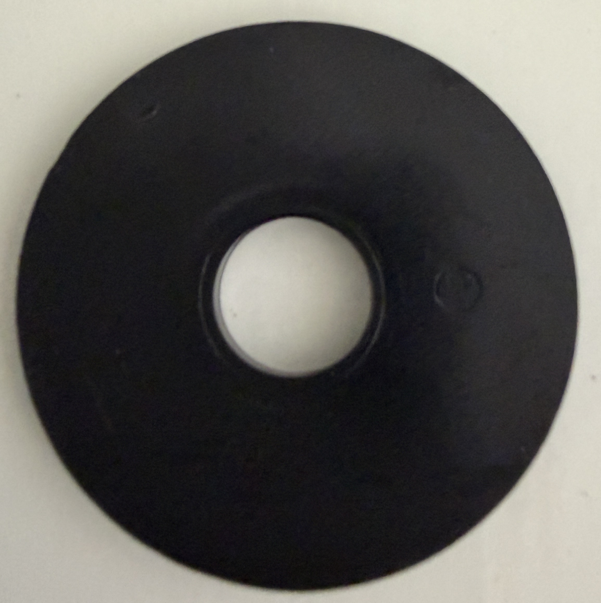

# Arcade Stick Cover

A wider copy of the stick's dust cover. The original (~38 mm) doesn't hide the marks around the panel hole:

  

Same profile as the original: 1 mm disc with a chamfered rim, a 2 mm conical boss in the middle and an 11 mm shaft hole. Only the outer diameter changes.

## Parts

| File | Qty | What it is |
|---|---|---|
| `arcade_stick_cover.stl` | 1 | Ø60 × 3 mm cover, already in print orientation |
| `arcade_stick_cover.py` | – | Parametric FreeCAD script that generates everything |
| `arcade_stick_cover.FCStd` | – | FreeCAD model |

## Printing

| Setting | Value |
|---|---|
| Printer | Bambu Lab A1 mini (fits the 180 × 180 bed) |
| Material | PLA or PETG, matte black |
| Layer height | 0.2 mm |
| Supports | none (flat underside on the bed) |

## Before printing: check the boss

`OUTER_D` is 60 mm, measured to cover the marks. The boss diameters (`BOSS_D0` 14, `BOSS_D1` 12.5) are estimated from the photos: measure them on the original and update them if they differ. `HOLE_CLR` adds 0.2 mm to the hole.

```bash
"/Applications/FreeCAD 1.1.0.app/Contents/Resources/bin/freecadcmd" arcade_stick_cover.py
```
