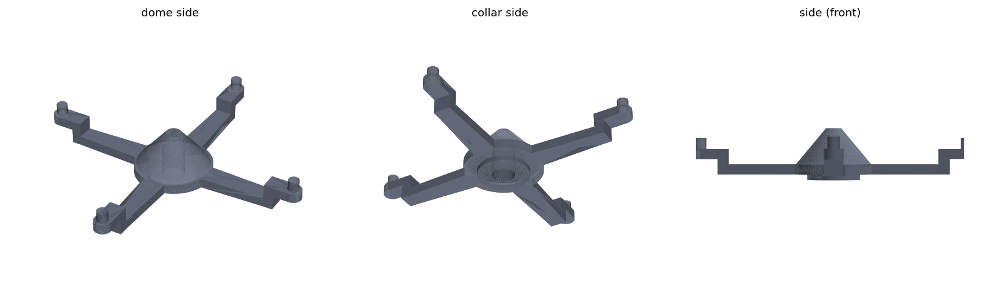

# DualShock 2 Pad Stabilizer

Replacement for the small grey 4-arm stabilizer inside a **DualShock 2** controller, modelled from caliper measurements of the original (photos in [imgs/](imgs/)). The original in the photos is broken and has lost one arm, so the model adds it back opposite the third arm.

- A **hub** with a cone-shaped dome on one side, and a collar with a 2.1 mm hole on the other.
- **Four thin arms** in a cross. Each arm steps up near its end into a short rounded tab with a pin on top, on the same side as the dome.



## Parts

| File | Qty | What it is |
|---|---|---|
| `pad_stabilizer.stl` | 1 | 25.9 × 25.9 × 4.7 mm stabilizer, in print orientation |
| `pad_stabilizer.py` | – | Parametric FreeCAD script that generates everything. |
| `pad_stabilizer.FCStd` | – | FreeCAD model. |

## Printing (Bambu Lab)

The arms are 0.9 mm thick and the pins are 1 mm wide, so this is a small, fine part for FDM.

| Setting | Value |
|---|---|
| Material | **PETG** (tough, flexes without snapping). ABS/ASA also works and is closest to the original. Avoid PLA: it is brittle in thin sections. |
| Nozzle | **0.2 mm** recommended. 0.4 mm works, but the pins and tabs come out rough. |
| Layer height | 0.08–0.1 mm |
| Walls | enough to make the arms solid (e.g. 4 with a 0.2 mm nozzle) |
| Infill | 100 % |
| Supports | tree, under the arms only (see below) |

The STL stands on its collar, with the dome and the pins pointing up. The collar is 0.5 mm taller than the flat side of the arms, so the arms sit 0.5 mm above the bed and need a thin support under them. If the collar doesn't need to be that tall in the pad, set `COLLAR_H = 0`: the arms then lie flat on the bed and no supports are needed.

A resin printer with a tough resin gives the cleanest result, if you have access to one.

## Before printing: check the measurements

Some dimensions could not be read clearly from the photos, or were not measured. Check them on the original and change them at the top of the script:

| Parameter | Default | What to measure |
|---|---|---|
| `COLLAR_H` | 0.5 | how far the collar stands out of the flat side of the arms (estimated from the photos) |
| `HOLE_DEPTH` | 3.0 | depth of the 2.1 mm hole (a blind hole is assumed) |
| `STEM_TIP` | 12.95 | hub center to the tip of the two Y arms (set equal to the X arms) |
| `STEP_H` | 2.3 | flat side of the arm to the top of the end tab |
| `PIN_H` / `PIN_D` | 1.0 / 1.0 | pin height and diameter |
| `TAB_L` | 1.6 | outer face of the step to the pin center |

Measured: dome Ø6.9, flange Ø7.3, collar Ø4.8, hole Ø2.1, hub height 4.7, span 25.9, arms 0.9 thick and 2.4 → 1.6 wide, end height 3.3.

Then run:

```bash
"/Applications/FreeCAD 1.1.0.app/Contents/Resources/bin/freecadcmd" pad_stabilizer.py
```

This regenerates the `.FCStd` and the STL, and prints the overall size.
