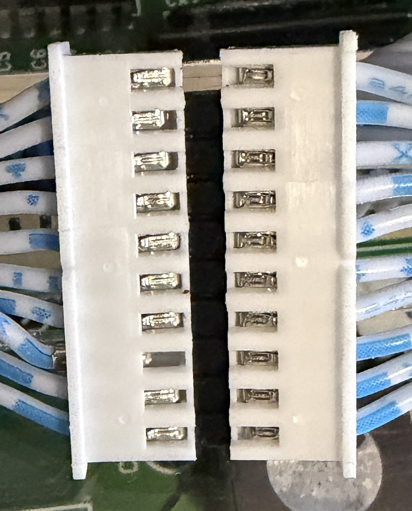
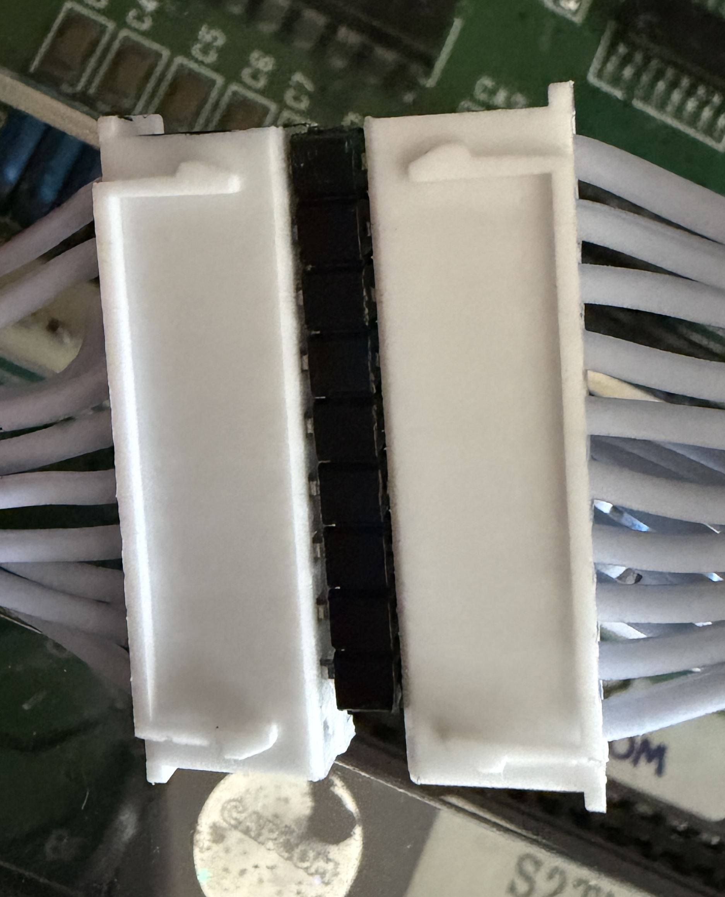
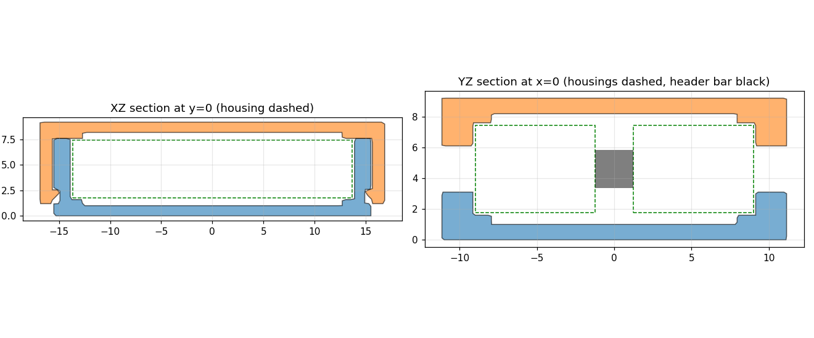

# JST XH Female-to-Female Coupler

Joins two 10-pin **JST XH** cable connectors (XHP-10 crimp housings, 2.5 mm pitch) end to end. They are plugged into a strip of **2.54 mm male-male pin header**, with its black plastic bar left on, and the coupler holds the whole stack in place:

 

- A **tray** (U channel) takes the two housings and the header. The wires leave through a slot in each end wall. The lips above and below the slot rest on the back of the housings, so a pull on the cables can't separate them.
- A **lid** snaps on with two hooks, closes the top of the wire slots and keeps the housings from lifting out.



## Keep the header bar

Use the pin header **with** its plastic bar:

- The bar fixes how deep the pins go into each housing (2.5 mm bar, ~3 mm of pin per side) and keeps the 10 pins aligned.
- Holding loose pins would need ten 0.7 mm square holes at 2.5 mm pitch. That is at the limit of FDM printing, and a loose pin could slide out on one side.
- The coupler doesn't hold the bar: the pins center it inside the two housings.

The header is 2.54 mm pitch and XH is 2.5 mm, so the outer pins are off by 0.18 mm. The photos show this already works. A 2.5 mm pitch strip would be a perfect fit, if you have one.

## Parts

| File | Qty | What it is |
|---|---|---|
| `tray.stl` | 1 | 31 × 22.3 × 7.6 mm cradle |
| `lid.stl` | 1 | Snap-on lid, 33.7 mm wide over the hooks |
| `jst_xh_coupler.py` | – | Parametric FreeCAD script that generates everything. |
| `jst_xh_coupler.FCStd` | – | FreeCAD model (parts in their assembled position). |

## Printing

| Setting | Value |
|---|---|
| Material | PETG (PLA works, but the hooks are less forgiving) |
| Layer height | 0.12–0.16 mm |
| Walls | 3 |
| Supports | none |

The STLs are already in print orientation: the tray on its floor and the lid upside down, with its flat face on the bed and the hooks pointing up.

## Assembly

1. Plug both connectors onto the pin header, as in the photos.
2. Lay the stack in the tray with the wires in the two slots. Either face of the housings can go down.
3. Press the lid on until both hooks click.

## Before printing: check the measurements

The defaults come from the JST XH datasheet (XHP-10: 27.3 × 5.7 × 7.5 mm + 0.25). Measure your parts with a caliper and change these at the top of the script if they differ:

| Parameter | Default | What to measure |
|---|---|---|
| `HOUSING_W` | 27.3 | housing length along the pin row, end posts included |
| `HOUSING_D` | 5.7 | housing thickness |
| `STACK_LEN` | 18.0 | **full length of the plugged stack** (housing + bar + housing). This is the most important one: replace the formula with your measurement. |
| `WIRE_Z` | 2.85 | height of the wire row above the face of the housing that lies on the tray floor (default: centered) |
| `WIRE_OD` | 1.9 | wire insulation diameter |

Fits: `CLR_W`, `CLR_D` and `CLR_L` are the clearances. If the hooks are too stiff or too loose, change `HOOK_NUB`. `LOCK_RELIEF` is a 0.6 mm pocket in the floor and the lid that leaves room for the XH lock bump.

Then run:

```bash
"/Applications/FreeCAD 1.1.0.app/Contents/Resources/bin/freecadcmd" jst_xh_coupler.py
```

This regenerates the `.FCStd` and both STLs, and prints the cavity size and the lip height on the housings.
